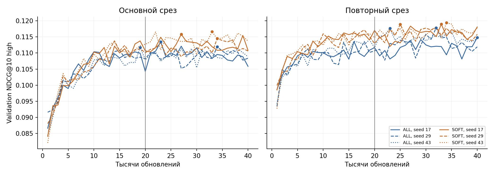

# Приложение к исследованию доли просмотра в BERT4Rec

## Формирование выборок

Один снимок KION содержит 5 476 251 агрегированную пару. После отбора фильмов остаётся 4 137 134 пары. Таблица раскрывает дальнейшее формирование каждого среза. Размеры validation и test относятся к первому наблюдаемому будущему дню пользователя. При отсутствии допустимых целей переход к следующему дню не выполняется. Каталог и выборка пользователей формируются до исследуемой обработки доли просмотра.

В таблице пропущенные количества не измерялись для соответствующего служебного этапа; они не равны нулю. Этап DELETE10_trainable показывает пользователей с минимум двумя сохранёнными фильмами. Его фильтрация относится только к обучению DELETE10 и не меняет общую оценочную популяцию.

### main

| stage | users | items | pairs |
| --- | --- | --- | --- |
| raw_snapshot | 962179 | 15706 | 5476251 |
| films_snapshot | 759559 | 11813 | 4137134 |
| train_known_pct | 628311 | 11357 | 3223057 |
| eligible_10plus | 81545 | 10928 | 1773300 |
| selected_training | 50000 | 10131 | 1085046 |
| DELETE10_retained_before_window | 49757 | 9130 | 805698 |
| DELETE10_trainable | 49426 | — | — |
| validation_raw_future | 15824 | 4059 | 56448 |
| validation_first_day_any | 15523 | 3089 | 25947 |
| validation_first_day_high | 8471 | 2122 | 11438 |
| test_raw_future | 14479 | 4091 | 49314 |
| test_first_day_any | 13829 | 2995 | 22265 |
| test_first_day_high | 7378 | 2052 | 9716 |

### replication

| stage | users | items | pairs |
| --- | --- | --- | --- |
| raw_snapshot | 962179 | 15706 | 5476251 |
| films_snapshot | 759559 | 11813 | 4137134 |
| train_known_pct | 548809 | 11144 | 2691223 |
| eligible_10plus | 66620 | 10686 | 1427484 |
| selected_training | 50000 | 10298 | 1069327 |
| DELETE10_retained_before_window | 49727 | 9213 | 794113 |
| DELETE10_trainable | 49403 | — | — |
| validation_raw_future | 16289 | 4206 | 57229 |
| validation_first_day_any | 16058 | 3224 | 26910 |
| validation_first_day_high | 9650 | 2367 | 13044 |
| test_raw_future | 15033 | 4149 | 51167 |
| test_first_day_any | 14522 | 3116 | 23828 |
| test_first_day_high | 7952 | 2201 | 10475 |

## Спецификация оценки

История ограничивается доступными строками до конца предшествующего периода. Известные каталогу фильмы с пропуском процента не подаются как контекст, но включаются в множество уже просмотренных. Целевой день определяется до удаления неизвестных каталогу объектов и строк с пропуском процента. Сначала берутся все строки этого дня, затем применяются правила допустимости целей. Цели являются множествами уникальных фильмов.

В задаче any релевантен любой допустимый фильм целевого дня. В задаче high релевантны только фильмы с зарегистрированным процентом не менее 50. Пользователи без целей high не участвуют в усреднении high, но остаются в any, если его цели непусты. У всех методов одинаковые популяции и множества целей.

Кандидаты — полный общий обучающий каталог за исключением всех известных прошлых просмотров, включая удалённые DELETE10. Для пользователя берутся до 19 контекстных фильмов и завершающий MASK. Модель выдаёт оценки всего каталога. Сортировка убывающая и стабильная: при равных оценках сохраняется порядок внутренних ID, соответствующий отсортированным исходным item_id. Сохраняется top-10. Вероятности показа или подвыборка негативов не используются.

Для непустого множества целей R показатель DCG@10 равен сумме 1{i_k ∈ R}/log₂(k+1), k=1,…,10. IDCG@10 использует те же скидки для первых min(10, |R|) позиций. NDCG@10 = DCG@10/IDCG@10; Recall@10 = число найденных целей / |R|. Непустые цели без попаданий дают ноль. Пустая релевантность даёт пропуск, исключаемый из соответствующего среднего. Сначала метрики усредняются по пользователям в каждой модели; среднее и выборочное SD публикуются по трём seed.

Для пользовательского bootstrap сначала усредняются метрики одного пользователя по трём обучающим seed. Затем одни и те же пользователи с возвращением выбираются для обеих сравниваемых моделей. В исходном эксперименте четыре основные разности NDCG используют 98,75%-интервалы (номинальная поправка Бонферрони); остальные интервалы 95% описательные. В проверках бюджета и порядка интервалы 95% исследовательские, без поправки. Все эти интервалы условны на обученных моделях и не заменяют неопределённость по seed.

## Учебные цели и выбор checkpoint

TARGET10 при нулевой сумме весов пропускает пакет без обновления оптимизатора. В исходных 30 моделях такие пакеты не встретились. Для каждого метода ниже приведены средние по трём seed накопленные количества за 20 000 обновлений. Индекс (Σw)²/Σw² описывает относительную концентрацию весов всех предъявленных целей; это не число независимых пользователей или уникальных наблюдений. DELETE10 меняет состав и длину окон, TARGET10 меняет веса; из равного числа шагов не следует равенство числа эффективных учебных целей.

| split | method | masked_positions | positive_weight_targets | effective_weighted_targets |
| --- | --- | --- | --- | --- |
| main | ALL | 14047131.333333 | 14047131.333333 | 14047131.333333 |
| main | DELETE10 | 11572804.333333 | 11572804.333333 | 11572804.333333 |
| main | SOFT | 14047131.333333 | 14047131.333333 | 11072610.059628 |
| main | STEP10 | 14047131.333333 | 14047131.333333 | 12503850.106363 |
| main | TARGET10 | 14047131.333333 | 10441519 | 10441519 |
| replication | ALL | 13992224.333333 | 13992224.333333 | 13992224.333333 |
| replication | DELETE10 | 11515201.666667 | 11515201.666667 | 11515201.666667 |
| replication | SOFT | 13992224.333333 | 13992224.333333 | 11113507.022600 |
| replication | STEP10 | 13992224.333333 | 13992224.333333 | 12468388.366467 |
| replication | TARGET10 | 13992224.333333 | 10433661.333333 | 10433661.333333 |

Выбор checkpoint: первое достижение максимального validation NDCG@10 high. Проверка выполняется каждые 1000 обновлений. Научные гиперпараметры одинаковы для правил; отдельный поиск лучших параметров каждого метода не выполнялся.

| split | method | seed | best_step |
| --- | --- | --- | --- |
| main | ALL | 17 | 10000 |
| main | ALL | 29 | 15000 |
| main | ALL | 43 | 19000 |
| main | DELETE10 | 17 | 16000 |
| main | DELETE10 | 29 | 18000 |
| main | DELETE10 | 43 | 20000 |
| main | SOFT | 17 | 19000 |
| main | SOFT | 29 | 14000 |
| main | SOFT | 43 | 14000 |
| main | STEP10 | 17 | 19000 |
| main | STEP10 | 29 | 15000 |
| main | STEP10 | 43 | 19000 |
| main | TARGET10 | 17 | 19000 |
| main | TARGET10 | 29 | 15000 |
| main | TARGET10 | 43 | 13000 |
| replication | ALL | 17 | 16000 |
| replication | ALL | 29 | 18000 |
| replication | ALL | 43 | 19000 |
| replication | DELETE10 | 17 | 18000 |
| replication | DELETE10 | 29 | 14000 |
| replication | DELETE10 | 43 | 18000 |
| replication | SOFT | 17 | 20000 |
| replication | SOFT | 29 | 18000 |
| replication | SOFT | 43 | 16000 |
| replication | STEP10 | 17 | 20000 |
| replication | STEP10 | 29 | 10000 |
| replication | STEP10 | 43 | 16000 |
| replication | TARGET10 | 17 | 20000 |
| replication | TARGET10 | 29 | 18000 |
| replication | TARGET10 | 43 | 16000 |

## Диагностика совпадающих дат

Диагностика ниже относится ко всем 50 000 выбранных пользователям каждого среза. Для test_context рассматривается доступный до теста контекст, включая валидационный период. Доли не следует интерпретировать как доли только оцениваемых пользователей.

| split | phase | window | users | users_with_tied_day | users_with_tied_day_share | pairs_in_tied_days | pairs | max_day_group | users_with_ties_in_window | window_cuts_day_group_users | window_cuts_day_group_share |
| --- | --- | --- | --- | --- | --- | --- | --- | --- | --- | --- | --- |
| main | train | 20 | 50000 | 49414 | 0.988280 | 740865 | 1085046 | 137 | 49401 | 8325 | 0.166500 |
| main | test_context | 19 | 50000 | 49447 | 0.988940 | 777536 | 1139491 | 137 | 49432 | 9665 | 0.193300 |
| replication | train | 20 | 50000 | 49452 | 0.989040 | 732779 | 1069327 | 241 | 49436 | 8039 | 0.160780 |
| replication | test_context | 19 | 50000 | 49491 | 0.989820 | 770722 | 1125668 | 241 | 49470 | 9697 | 0.193940 |

## Дополнительная проверка бюджета

Согласованная проверка ALL/SOFT использует 12 траекторий по 40 000 обновлений. На границе 20 000 отдельно сохранён лучший validation-checkpoint, и та же траектория продолжена. Тестовые сравнения двух бюджетов основаны на разных validation-выборах одной траектории, поэтому наблюдения парные. Бюджет не выбирается по тесту.

| split | method | seed | budget | selected_step | validation_ndcg | ndcg10_high |
| --- | --- | --- | --- | --- | --- | --- |
| main | ALL | 17 | 20000 | 10000 | 0.110396 | 0.093658 |
| main | ALL | 17 | 40000 | 23000 | 0.113484 | 0.098191 |
| main | ALL | 29 | 20000 | 15000 | 0.110781 | 0.093078 |
| main | ALL | 29 | 40000 | 34000 | 0.111920 | 0.094030 |
| main | ALL | 43 | 20000 | 19000 | 0.111748 | 0.094703 |
| main | ALL | 43 | 40000 | 19000 | 0.111748 | 0.094703 |
| main | SOFT | 17 | 20000 | 19000 | 0.113746 | 0.098937 |
| main | SOFT | 17 | 40000 | 27000 | 0.115834 | 0.098470 |
| main | SOFT | 29 | 20000 | 14000 | 0.113772 | 0.096062 |
| main | SOFT | 29 | 40000 | 34000 | 0.114538 | 0.098867 |
| main | SOFT | 43 | 20000 | 14000 | 0.113407 | 0.098915 |
| main | SOFT | 43 | 40000 | 33000 | 0.116631 | 0.098872 |
| replication | ALL | 17 | 20000 | 16000 | 0.113582 | 0.097672 |
| replication | ALL | 17 | 40000 | 40000 | 0.114806 | 0.099290 |
| replication | ALL | 29 | 20000 | 18000 | 0.113588 | 0.098600 |
| replication | ALL | 29 | 40000 | 32000 | 0.117824 | 0.100566 |
| replication | ALL | 43 | 20000 | 19000 | 0.114095 | 0.096219 |
| replication | ALL | 43 | 40000 | 23000 | 0.117642 | 0.101315 |
| replication | SOFT | 17 | 20000 | 20000 | 0.117020 | 0.101512 |
| replication | SOFT | 17 | 40000 | 33000 | 0.118977 | 0.105228 |
| replication | SOFT | 29 | 20000 | 18000 | 0.117181 | 0.099840 |
| replication | SOFT | 29 | 40000 | 25000 | 0.118908 | 0.104805 |
| replication | SOFT | 43 | 20000 | 16000 | 0.116814 | 0.104188 |
| replication | SOFT | 43 | 40000 | 34000 | 0.119395 | 0.103084 |

Линии показывают три seed каждого метода; точки — выбранный первый максимум в пределах 40 000. Вертикальная линия отмечает прежний бюджет. Графики показывают зависимость качества от бюджета, но сами по себе не устанавливают достижение сходимости.

## Проверка воспроизводимости

Исходные результаты независимо проверены по закреплённому KION и сохранённым ранжированным ID: 898 980 пользовательских строк validation/test и 32 bootstrap-интервала. Дополнительная проверка бюджета воспроизведена по 340 212 тестовым строкам и 32 интервалам. Состав когорт, каталоги и цели совпадают с исходным протоколом. Контрольные суммы сохранённых файлов весов проверены.

В новой среде первые 20 000 шагов точно воспроизвели пользовательские метрики 12 исходных моделей. В шести строках отличаются ранжированные ID без изменения сохранённых метрик. Новая среда: Python 3.13.16, PyTorch 2.11.0+cu130, NumPy 2.1.3, pandas 2.3.3, Tesla T4; исходная: Python 3.13.15 и PyTorch 2.11.0+cu128. Полная транзитивная среда исходного запуска не была сохранена. Побитовое совпадение произвольных сред и GPU не гарантируется.

Полные веса и состояние оптимизатора дополнительного запуска сохранены в отдельном полном архиве. Сырые данные KION распространяются исходным источником; сопровождающий код закрепляет ревизию и проверяет SHA-256. Публикуемые агрегаты не содержат индивидуальных пользовательских рекомендаций.

## Стресс тест порядка внутри дня при инференсе

Сохранённые checkpoints расширенного бюджета проверены в исходном порядке и при трёх фиксированных перестановках с seed 20261103, 20261104, 20261105. Ключ перестановки — детерминированное смешивание ID пользователя, ID фильма и даты (SplitMix64). Процент просмотра и будущие цели в ключ не входят. Переупорядочивается полное известное прошлое внутри дня до взятия последних 19 объектов; поэтому может меняться и состав окна. Веса и целевые множества остаются прежними.

| split | permutation_seed | users | contexts_order_changed | contexts_item_set_changed | high_users |
| --- | --- | --- | --- | --- | --- |
| main | 20261103 | 13829 | 13085 | 2662 | 7378 |
| main | 20261104 | 13829 | 13049 | 2587 | 7378 |
| main | 20261105 | 13829 | 13087 | 2599 | 7378 |
| replication | 20261103 | 14522 | 13748 | 2760 | 7952 |
| replication | 20261104 | 14522 | 13753 | 2730 | 7952 |
| replication | 20261105 | 14522 | 13742 | 2736 | 7952 |

В предыдущей таблице users — популяция any, high_users — её подмножество high. contexts_order_changed учитывает любое изменение списка, contexts_item_set_changed — изменение состава, независимо от порядка. При перестановках порядок или состав изменился примерно у 94–95% оцениваемых пользователей, состав — примерно у 19%.

| split | scenario | ALL_ndcg10_high | SOFT_ndcg10_high | SOFT_ALL_delta | SOFT_ALL_relative_pct |
| --- | --- | --- | --- | --- | --- |
| main | baseline | 0.095648 | 0.098733 | 0.003085 | 3.225057 |
| main | permuted_20261103 | 0.095226 | 0.098499 | 0.003273 | 3.437423 |
| main | permuted_20261104 | 0.095316 | 0.097682 | 0.002366 | 2.481842 |
| main | permuted_20261105 | 0.095386 | 0.098005 | 0.002619 | 2.745925 |
| main | permutation_average | 0.095309 | 0.098062 | 0.002753 | 2.888188 |
| replication | baseline | 0.100400 | 0.104391 | 0.003991 | 3.974852 |
| replication | permuted_20261103 | 0.099812 | 0.104105 | 0.004294 | 4.301654 |
| replication | permuted_20261104 | 0.100224 | 0.104497 | 0.004273 | 4.263695 |
| replication | permuted_20261105 | 0.100440 | 0.104484 | 0.004044 | 4.026540 |
| replication | permutation_average | 0.100159 | 0.104362 | 0.004204 | 4.197030 |

Среднее permutation_average сначала усредняет три обучающих seed внутри каждого пользователя и сценария, затем три перестановки. Это условное среднее по девяти фиксированным оценкам, а не новая модель и не усреднение вероятностей перед ранжированием.

| split | contrast | mean_difference | low | high |
| --- | --- | --- | --- | --- |
| main | SOFT-ALL | 0.002753 | 0.001035 | 0.004429 |
| main | ALL_permuted-baseline | -0.000338 | -0.001027 | 0.000370 |
| main | SOFT_permuted-baseline | -0.000670 | -0.001335 | -0.000017 |
| main | change_in_SOFT_ALL_gap | -0.000332 | -0.000998 | 0.000346 |
| replication | SOFT-ALL | 0.004204 | 0.002379 | 0.005991 |
| replication | ALL_permuted-baseline | -0.000241 | -0.000869 | 0.000397 |
| replication | SOFT_permuted-baseline | -0.000028 | -0.000643 | 0.000600 |
| replication | change_in_SOFT_ALL_gap | 0.000213 | -0.000467 | 0.000916 |

Парные описательные 95%-интервалы получены 5000 пользовательскими bootstrap-повторениями с seed 20261103. Обучающие seed и перестановки фиксированы; неопределённость по всем возможным порядкам не оценивается. Поправка на множественность новых сравнений не применяется.

Выполнен CPU-инференс в Python 3.12.14, PyTorch 2.9.0+cpu, NumPy 2.3.5 и pandas 3.0.1, FP32, четыре CPU-потока. Исходный порядок заново оценён в той же среде. Максимальное отличие средней NDCG high одной модели от сохранённого GPU-результата равно 0,0000882. Всего 4583 ранжированных пользовательских списка отличаются от GPU-вывода; поэтому парные разности перестановок используют собственный CPU-контроль. Побитовое совпадение сред не заявляется.

Эта проверка оценивает чувствительность готовых прогнозов к изменениям контекста. Она не устанавливает устойчивость к альтернативному порядку при обучении и не восстанавливает неизвестную последовательность сеансов. Все численные результаты и пользовательские строки инференса сохранены локально; в публичный пакет включены только агрегаты и протокол.
