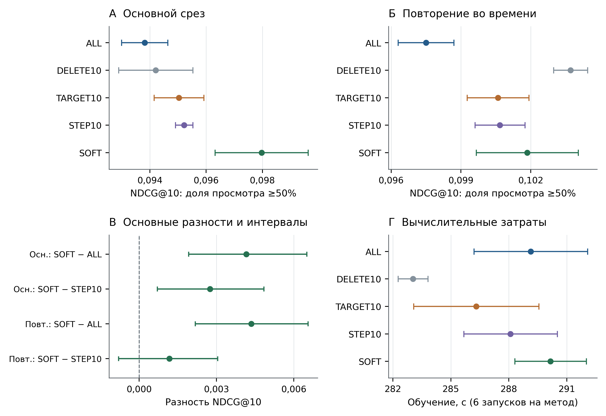
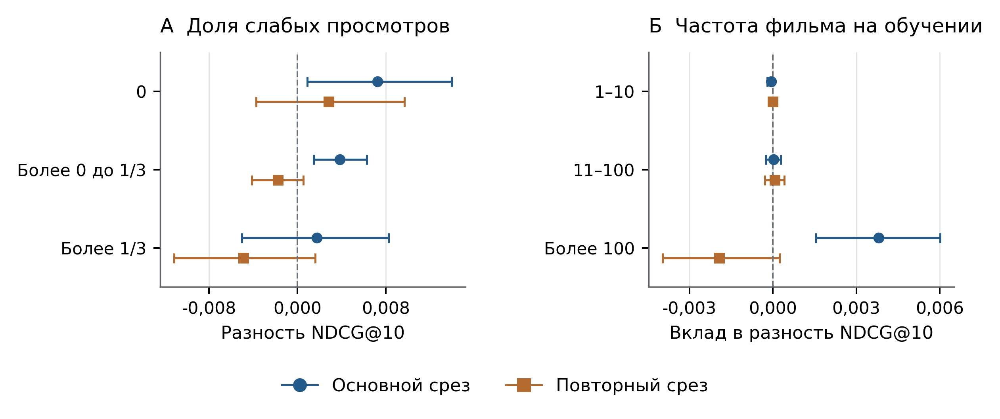

# Учёт доли просмотра как неявной обратной связи в BERT4Rec

**Аннотация.** Исследуется влияние обработки доли просмотра фильма на качество последовательных рекомендаций BERT4Rec. Сравниваются равные веса взаимодействий, удаление просмотров до 10%, исключение таких просмотров только из учебных целей, ступенчатые и плавные веса. Основной эксперимент выполнен на двух временных срезах KION с одинаковой архитектурой, бюджетом 20 000 шагов и тремя случайными инициализациями. В доступном снимке агрегированных пар плавное правило SOFT повышает тестовый NDCG@10 для будущих целей с зарегистрированной долей просмотра не менее 50% относительно равных весов на 4,43 и 4,46%. При расширении бюджета пары ALL/SOFT до 40 000 преимущество сохраняется: 3,24 и 3,97%. Преимущество перед ступенчатым правилом при исходном бюджете подтверждается только на основном срезе; на повторном наибольшее среднее качество даёт удаление слабых просмотров. Аддитивный анализ локализует основной прирост SOFT относительно ALL преимущественно в популярных фильмах. Вывод относится к проверенным правилам и условиям; точная история отдельных сеансов в KION не восстанавливается.

**Ключевые слова:** рекомендательные системы, неявная обратная связь, BERT4Rec, доля просмотра, взвешивание функции потерь, KION.

## Введение

Факт просмотра не показывает, насколько содержательным было взаимодействие. Короткое знакомство с фильмом и просмотр большей его части могут давать разные учебные сигналы. Различение предпочтения и уверенности в неявной обратной связи предложено в работе Hu и соавторов [1]. В системе YouTube наблюдаемое время просмотра использовалось для взвешивания положительных примеров при обучении ранжирования [2]. Поэтому сам принцип взвешивания просмотров не является новым.

BERT4Rec восстанавливает скрытые объекты по окружающей истории [3]. В такой задаче просмотр одновременно может служить контекстом для других объектов и целью восстановления. Удаление взаимодействия меняет обе роли; нулевой вес его ошибки меняет только роль учебной цели. Это различие позволяет сопоставить простые способы использования доли просмотра без изменения архитектуры.

Близкий практический ориентир — пример RecTools с весом 1 для доли просмотра до 10% включительно и весом 3 выше этого порога [4]. Более сложные решения обучают отбор элементов последовательности, как RAP [5], либо отдельно моделируют пассивную отрицательную обратную связь в коротких видео, как SINE [6]. D²Co корректирует длительность просмотра с учётом шума и зависимости от длины видео [7]. Такие постановки отличаются от сравнения простых весов в фиксированной BERT4Rec. В частности, малую долю просмотра фильма нельзя автоматически интерпретировать как отрицательную оценку.

Цель работы — определить, как отбор и взвешивание зарегистрированных просмотров влияют на качество компактной BERT4Rec. Исследуются три вопроса: улучшает ли SOFT прогноз относительно равных весов ALL; сохраняется ли направление эффекта на повторном временном срезе и при сравнении с другими правилами; в каких частях каталога возникает средний прирост. Вклад состоит в контролируемом сравнении пяти конкретных правил на общей когорте и каталоге. Новизна не состоит в самом принципе взвешивания или в доказательстве универсального преимущества непрерывной функции весов.

## Данные и методы

Использован открытый KION [8]. В нём одна строка соответствует паре пользователь–объект: сохранена последняя дата взаимодействия, а длительность и процент агрегированы по просмотрам. Следовательно, строка не является отдельным сеансом. Рассматриваются только объекты типа «фильм», чтобы не смешивать их с сериалами. Пропуски доли просмотра исключаются из обучающих историй и допустимых целей; нулевые значения сохраняются.

Задача определяется как прогноз будущих наблюдаемых агрегированных пар в данном снимке данных. Если фильм смотрели до границы обучения и повторно после неё, доступная строка с последней датой может не сохранить раннее взаимодействие в восстановленной истории. Поэтому календарное разбиение строк не восстанавливает точный журнал знаний системы на историческую дату. Это ограничение реконструкции; по доступным материалам не установлено попадание будущих строк в обучение. Точные последовательности сеансов и момент достижения доли просмотра восстановить нельзя.

Общая временная шкала используется для ограничения доступа к будущим данным [9]. На основном срезе обучение ограничено 1 августа 2021 года, валидация — 2–8 августа, тест — 9–15 августа. На повторном срезе соответствующие границы — 18 июля, 19–25 июля и 26 июля — 1 августа. Для каждого среза по обучающей части независимо выбираются 50 000 пользователей с историей не менее десяти различных фильмов с известной долей просмотра. Выбор выполняется до применения исследуемых правил; каталог также определяется только по этой обучающей части. Объёмы составляют соответственно 1 085 046 и 1 069 327 пар, каталоги — 10 131 и 10 298 фильмов.

Пусть r — зарегистрированная доля просмотра в диапазоне от 0 до 1. Сравниваемые правила приведены в таблице 1. Во всех вариантах модель предсказывает ID фильма; доля просмотра не подаётся в Transformer как входной признак. Она используется при подготовке истории и вычислении веса ошибки восстановления.

Таблица 1. Обработка взаимодействий и вес учебной цели

| Правило | История | Вес w(r) |
| --- | --- | --- |
| ALL | Сохраняется | 1 |
| DELETE10 | Удаляются просмотры r ≤ 0,1 | 1 для оставшихся |
| TARGET10 | Сохраняется | 0 при r ≤ 0,1; иначе 1 |
| STEP10 | Сохраняется | 1 при r ≤ 0,1; иначе 3 |
| SOFT | Сохраняется | 0,2 + 0,8r |

Для множества скрытых позиций M в мини-пакете минимизируется нормированная взвешенная кросс-энтропия:

$$
\mathcal{L}=-\frac{\sum_{t\in M}w(r_t)\log P_\theta(i_t\mid\widetilde{s})}{\sum_{t\in M}w(r_t)}.
$$

Здесь iₜ — исходный объект в позиции t, s̃ — история после маскирования, а w(rₜ) — вес этой цели. Нормировка на сумму весов сохраняет смысл их относительного соотношения: умножение всех весов на одну константу не меняет функцию потерь. Нулевой вес TARGET10 не превращает просмотр в отрицательную метку; такая позиция по-прежнему может быть скрыта.

Порог 10% и веса STEP10 взяты как известный практический ориентир [4]. SOFT — заранее заданная линейная эвристика: она сохраняет ненулевой вклад коротких просмотров и плавно увеличивает его до единицы. Нижняя граница 0,2 ограничивает отношение максимального и минимального весов величиной 5. Оптимальность этой границы и порогов не утверждается; они не подбирались по тестовым результатам.

STEP10 и SOFT различаются одновременно формой и относительным контрастом весов. Поэтому их сопоставление оценивает две конкретные эвристики; из него нельзя отдельно вывести эффект плавности. Общие архитектура, оптимизатор и параметры обучения использованы как единая фиксированная конфигурация; отдельный поиск оптимальных настроек для каждого правила в этой серии не выполнялся.

Использована компактная реализация BERT4Rec с ID объектов, обучаемыми позициями, двунаправленным вниманием, GELU и общими входными и выходными эмбеддингами. Все выбранные для восстановления позиции заменяются токеном MASK. Параметры приведены в таблице 2. Они зафиксированы для сравнения обработки обратной связи, а не заявляются оптимальными: результаты BERT4Rec могут зависеть от реализации и бюджета обучения [10]. Оптимизатор — AdamW [11].

Таблица 2. Общие параметры модели и обучения

| Параметр | Значение | Параметр | Значение |
| --- | --- | --- | --- |
| Transformer-блоки | 2 | Максимум на обучении | 20 объектов |
| Размерность | 64 | Вход при рекомендации | До 19 + MASK |
| Головы внимания | 2 | Вероятность маски | 0,35 |
| Внутренний слой | 256 | Dropout | 0,1 |
| Оптимизатор | AdamW | Learning rate | 0,001 |
| Weight decay | 0,01 | Размер мини-пакета | 128 |
| Норма градиента | Не более 5 | Точность | FP32 |
| Шаги на запуск | 20 000 | Валидация | Каждые 1000 шагов |
| Seed | 17, 29, 43 | GPU | Tesla T4 |

История упорядочивается по последней дате, а внутри дня — по ID фильма. На обучение поступают последние максимум 20 объектов; при рекомендации используются до 19 известных объектов и завершающий MASK. Маскирование динамическое, с вероятностью 0,35; для каждой обучающей истории остаются хотя бы одна скрытая и одна видимая позиция. В DELETE10 удаление выполняется до обрезки окна, в том числе при рекомендации. После удаления 574 и 597 пользователей соответственно имеют менее двух объектов и не участвуют в обучении этого варианта, но сохраняются в общей оценке. Всего обучены 30 моделей: пять правил, два среза, три seed.

Повторная диагностика исходных историй показала, что несколько фильмов с одной датой встречаются у 98,828% выбранных пользователей основного среза и 98,904% повторного. Граница обучающего окна пересекает дневную группу соответственно у 16,650 и 16,078% пользователей. Таким образом, сортировка внутри дня потенциально меняет и позиции, и состав усечённого окна. Эти доли описывают все 50 000 выбранных пользователей каждого среза, а не только тестовую популяцию. Чувствительность входных контекстов отдельно проверяется на сохранённых весах; альтернативный порядок при самом обучении не исследован.

## Оценка качества

Для каждого пользователя цели берутся из первого наблюдаемого дня соответствующего будущего периода. Из-за отсутствия порядка внутри дня это множество фильмов, а не одно точно следующее событие. День определяется до исключения неизвестных каталогу объектов и пропусков; перехода к более позднему дню при отсутствии допустимых целей нет. В тесте контекст включает доступные взаимодействия до конца валидационного периода; веса модели после обучения не обновляются. Из кандидатов исключаются все известные прошлые просмотры, включая удалённые DELETE10.

Основная метрика — NDCG@10 с бинарной релевантностью фильмов, доля просмотра которых не менее 50%; дополнительно рассчитывается Recall@10. Ранжируется весь общий обучающий каталог без подвыборки негативных объектов, поскольку такая подвыборка может менять сравнение методов [12]. В основной тестовой популяции 7 378 пользователей, на повторном срезе — 7 952. Отдельно оцениваются любые допустимые просмотры того же первого дня: соответственно 13 829 и 14 522 пользователя. Популяции двух задач различаются, но внутри каждой задачи одинаковы для всех методов.

Для каждого запуска выбирается первое состояние с максимальным валидационным NDCG@10 высокой доли просмотра. Все выбранные модели оцениваются на тесте. Четыре основных сравнения, заданных до расчёта тестовых метрик, — SOFT против ALL и STEP10 на каждом срезе. Парный пользовательский bootstrap [13] выполняется с 5000 повторениями после усреднения метрик пользователя по трём seed. Уровень каждого основного интервала — 98,75%, что соответствует номинальной поправке Бонферрони для четырёх сравнений при общей ошибке 5%. Интервалы условны на обученных моделях; стандартное отклонение между seed приводится отдельно. Остальные интервалы 95% имеют описательный характер.

При нулевой сумме весов TARGET10 пакет пропускается без обновления оптимизатора; в исходных 30 запусках такие пакеты не встретились. При отсутствии допустимых целей высокой доли пользователь исключается только из соответствующей метрики, сохраняясь в задаче любого допустимого просмотра. Формулы, крайние случаи evaluator, воронка исключений и сведения об эффективных учебных целях раскрыты в приложении. Будущая зарегистрированная доля используется для определения тестовой релевантности и не подаётся в модель как признак.

Для дополнительного исследовательского сравнения SOFT и DELETE10 пользователи разделены по полной длине истории (10–19, 20–49, не менее 50 фильмов), доле просмотров ≤10% в последних максимум 19 объектах (0, до 1/3 включительно, более 1/3) и изменению длины контекста после удаления. Признаки определены до теста. Вклады фильмов сгруппированы по обучающей частоте (1–10, 11–100, более 100 зрителей) и рассчитаны с общим IDCG пользователя, поэтому суммируются в исходную NDCG. Этот анализ выполнен после получения общих результатов; его 95%-интервалы описательные и не учитывают множественность сравнений.

## Результаты и обсуждение

Результаты для высокой доли просмотра приведены в таблице 3 и на рисунке 1. По сравнению с ALL плавное взвешивание повышает средний NDCG@10 на 4,43% на основном срезе и на 4,46% на повторном. Абсолютные разности составляют 0,004158 и 0,004350; основные интервалы — [0,001921; 0,006506] и [0,002181; 0,006556]. Направление выигрыша сохраняется для всех трёх seed на обоих срезах.

Таблица 3. Тестовое качество для доли просмотра не менее 50%

| Метод | NDCG основной | NDCG повторный | Recall основной | Recall повторный |
| --- | --- | --- | --- | --- |
| ALL | 0,09381 ± 0,00082 | 0,09750 ± 0,00120 | 0,15235 | 0,15776 |
| DELETE10 | 0,09421 ± 0,00132 | **0,10371 ± 0,00073** | 0,15388 | **0,16495** |
| TARGET10 | 0,09503 ± 0,00088 | 0,10059 ± 0,00133 | 0,15499 | 0,16130 |
| STEP10 | 0,09522 ± 0,00031 | 0,10068 ± 0,00107 | 0,15490 | 0,16076 |
| SOFT | **0,09797 ± 0,00165** | 0,10185 ± 0,00219 | **0,15890** | 0,16216 |

Для NDCG приведены среднее ± выборочное стандартное отклонение трёх seed; для Recall — среднее. Жирным выделен наибольший средний результат в столбце; это не означает доказанного превосходства над всеми методами.

Рисунок 1. Сравнение способов обработки просмотров. А и Б — NDCG@10 высокой доли просмотра, среднее ± SD трёх seed; В — четыре основные разности и пользовательские интервалы 98,75%; Г — чистое время обучения, среднее ± SD шести запусков на метод по двум срезам.

Сравнение со STEP10 даёт более ограниченный вывод. На основном срезе прирост SOFT равен 2,89%, интервал абсолютной разности — [0,000705; 0,004844]. На повторном прирост составляет 1,16%, но интервал [−0,000803; 0,003047] включает ноль. Следовательно, преимущество конкретного правила SOFT перед STEP10 на обоих срезах не подтверждено.

На повторном срезе DELETE10 имеет наибольшие средние NDCG@10 и Recall@10. Однако описательный интервал SOFT − DELETE10 включает ноль: [−0,003899; 0,000332]. Сохранение слабых просмотров только как контекста также не даёт устойчивого преимущества: для TARGET10 − DELETE10 интервал на основном срезе включает ноль, а на повторном отрицателен [−0,005245; −0,001023]. Удаление меняет длину и состав окон, поэтому это сравнение способов обработки, а не изолированный причинный эффект контекста.

Для любого просмотра прирост NDCG@10 SOFT относительно ALL меньше: 1,18 и 2,08%. На основном срезе описательный интервал разности включает ноль, на повторном положителен. Для Recall@10 изменения составляют 2,53 и 0,27%; положительный интервал есть только на основном срезе. Поэтому результат для высокой доли нельзя переносить на все просмотры без уточнения задачи.

Среднее чистое время обучения ALL составляет 288,07 и 290,20 с на модель, SOFT — 289,14 и 291,17 с. Различия менее 0,4% малы относительно наблюдаемого разброса; ускорение SOFT не установлено. Совокупное чистое обучение 30 моделей занимает 2,39 ч на одной Tesla T4 в FP32; валидация — ещё 0,42 ч. Подготовка данных, тест и bootstrap в эти значения не входят.

Проверка сохранённых 600 точек валидации установила, что у 16 из 30 моделей лучший checkpoint находится на шагах 18 000–20 000, у четырёх — непосредственно на 20 000. Равный бюджет обеспечивает сравнение при фиксированном числе обновлений, но не доказывает одинаковой или достаточной сходимости методов. Средняя накопленная функция потерь в сохранённых кривых не является отдельной оценкой локального градиента или плато. Это послужило основанием для отдельной проверки увеличенного бюджета главной пары ALL и SOFT.

Для основной тестовой популяции высокой доли средний по seed охват каталога ALL составляет 13,55 и 14,89%, SOFT — 14,42 и 15,12%, DELETE10 — 15,66 и 16,17%. Это доля различных рекомендованных объектов в объединении top-10 пользователей относительно общего обучающего каталога; она зависит от размера популяции. Одновременно SOFT повышает среднюю log(1 + обучающая частота) рекомендованных фильмов: 7,194 → 7,288 и 7,075 → 7,149. Прирост точности сопровождается более популярными рекомендациями; охват не устанавливает новизну, удовлетворённость или коммерческую пользу.

## Проверка чувствительности к бюджету обучения

После основного анализа выполнена исследовательская проверка ALL и SOFT: два временных среза, три seed, 12 моделей до 40 000 обновлений. Архитектура, обучающая выборка и гиперпараметры сохранены. На границе 20 000 сохранён лучший доступный валидационный checkpoint; затем та же траектория обучения продолжена до 40 000. Для каждого бюджета независимо выбирался первый максимум валидационной метрики, а тест всех выбранных моделей рассчитывался после завершения очереди. Новая среда использовала Python 3.13.16 и PyTorch 2.11.0+cu130 на Tesla T4; отличие от исходной среды раскрывается в сопровождающем пакете. Первые 20 000 шагов воспроизвели исходные пользовательские значения метрик этой пары.

Таблица 4. NDCG@10 высокой доли просмотра при двух бюджетах

| Срез | Бюджет | ALL | SOFT | SOFT к ALL |
| --- | --- | --- | --- | --- |
| Основной | 20 000 | 0,093813 | 0,097971 | +4,43% |
| Основной | 40 000 | 0,095641 | 0,098736 | +3,24% |
| Повторный | 20 000 | 0,097497 | 0,101847 | +4,46% |
| Повторный | 40 000 | 0,100390 | 0,104372 | +3,97% |

При 40 000 шагах абсолютная разность SOFT − ALL равна 0,003095 на основном срезе и 0,003982 на повторном. Описательные парные 95%-интервалы составляют [0,001331; 0,004827] и [0,002170; 0,005875]. Относительное преимущество сохраняется, хотя его точечная оценка ниже, чем при 20 000 шагах. Само снижение двух точечных оценок не является проверкой значимости изменения эффекта. Для ALL увеличение бюджета поддерживается положительными интервалами на обоих срезах; для SOFT — только на повторном. На основном срезе интервал SOFT для разности 40k − 20k включает ноль: [−0,000940; 0,002492].

У 11 из 12 моделей лучший валидационный checkpoint расположен позже 20 000 шагов; у одной модели ALL повторного среза — на границе 40 000. Следовательно, бюджет существенно влияет на качество, но достаточная сходимость всех моделей при 40 000 не установлена. Проверка выполнена на ранее изученных тестовых периодах; её 95%-интервалы условны на обученных моделях, описательны и не учитывают множественность дополнительных сравнений. Они не заменяют исходные основные интервалы 98,75%. STEP10, TARGET10 и DELETE10 в этом расширении не обучались, поэтому их ранжирование при 40 000 шагах неизвестно.

## Перестановки внутри дня при рекомендации

На сохранённых validation-checkpoints расширенного бюджета выполнен стресс-тест без обучения. Для каждого пользователя известные до теста фильмы переупорядочивались только внутри одной зарегистрированной даты, после чего снова выбирались последние максимум 19 объектов. Три фиксированные перестановки с seed 20261103, 20261104 и 20261105 определялись по ID пользователя, ID фильма и дате, без будущей обратной связи. Целевые множества, пользователи и исключения уже просмотренных фильмов оставались прежними. Проверены 12 моделей и четыре контекста — исходный и три перестановки, всего 48 оценок.

Инференс выполнен на CPU в PyTorch 2.9.0. Поэтому исходный порядок также оценён заново в этой среде, и все разности перестановок рассчитаны относительно собственного CPU-контроля. Максимальное отличие среднего NDCG высокой доли отдельной модели от сохранённой GPU-оценки составило 0,0000882; пользовательские ранжирования не совпадают побитово. Результаты двух сред не смешиваются в парных разностях.

Таблица 5. Средний NDCG@10 высокой доли при перестановках входного контекста

| Срез | Порядок при инференсе | ALL | SOFT | SOFT к ALL |
| --- | --- | --- | --- | --- |
| Основной | Исходный, CPU | 0,095648 | 0,098733 | +3,23% |
| Основной | Среднее трёх перестановок | 0,095309 | 0,098062 | +2,89% |
| Повторный | Исходный, CPU | 0,100400 | 0,104391 | +3,97% |
| Повторный | Среднее трёх перестановок | 0,100159 | 0,104362 | +4,20% |

Внутри каждой перестановки положительное направление SOFT − ALL сохраняется на обоих срезах. После усреднения по трём обучающим seed и трём перестановкам абсолютные разности составляют 0,002753 и 0,004204; описательные парные 95%-интервалы — [0,001035; 0,004429] и [0,002379; 0,005991]. Интервалы изменения самой разности SOFT − ALL относительно исходного CPU-порядка включают ноль на обоих срезах. Это не доказывает эквивалентность порядков. На основном срезе средняя NDCG SOFT при перестановках уменьшается на 0,000670, поэтому нечувствительность самих прогнозов также не утверждается.

Стресс-тест поддерживает устойчивость положительного направления эффекта к проверенным изменениям входного порядка. Он условен на сохранённых весах, трёх конкретных перестановках и известных тестовых периодах; интервалы не учитывают множественность новых сравнений. Веса обучены на порядке по ID, поэтому устойчивость к переупорядочиванию при обучении этим опытом не установлена. Перестановка входа меняет распределение контекстов и не восстанавливает неизвестный истинный порядок сеансов.

## Локализация основного эффекта SOFT относительно ALL

В обоих срезах почти весь чистый прирост NDCG@10 SOFT относительно ALL приходится на фильмы, встречающиеся более чем у 100 обучающих пользователей. Их аддитивный вклад равен 0,004207 на основном срезе и 0,004176 на повторном, при общих приростах 0,004158 и 0,004350. Это соответственно 101,17 и 95,99% чистой разности: доля выше 100% на основном срезе возникает из-за небольшого отрицательного вклада менее популярных групп. На эти популярные фильмы приходится 83,19 и 85,16% будущих целей высокой доли. Разложение использует исходный полный IDCG пользователя и суммируется в общую NDCG; переобучение с удалением фильмов не выполнялось. Локализация описывает, где наблюдается выигрыш, но не объясняет причинно, почему он возник.

## Анализ различий SOFT и DELETE10

Дополнительный анализ не выявил устойчивого выбора между SOFT и DELETE10 по одной длине истории или доле слабых просмотров. Например, для историй 20–49 фильмов средняя разность SOFT − DELETE10 меняется с 0,003805 на основном срезе до −0,004203 на повторном. Доли групп по слабым просмотрам при этом близки: без таких просмотров — 8,20 и 8,65%, с долей до 1/3 включительно — 74,56 и 74,81% (рисунок 2А). Поэтому по этим данным нельзя обосновать переносимое правило переключения обработки для зрителей.

Разложение по фильмам локализует разность в популярной части каталога. На объекты с более чем 100 зрителями в обучающей когорте приходится 83,19 и 85,16% будущих целевых взаимодействий. Их аддитивный вклад в SOFT − DELETE10 составляет 0,003802 и −0,001925 (рисунок 2Б). Для менее популярных групп убедительного выигрыша SOFT не наблюдается. На основном срезе вклад фильма Wrath of Man равен 0,002224 — около 59% суммарной разности именно SOFT − DELETE10; на повторном его вклад отрицателен. Это описательная декомпозиция метрики, не причинное объяснение смены лидера. Улучшение средней оценки не доказывает улучшение рекомендаций редких фильмов.

Рисунок 2. Дополнительный анализ SOFT − DELETE10. А — разности NDCG@10 внутри групп по доле прошлых просмотров ≤10%; Б — аддитивные вклады групп фильмов по числу зрителей на обучении, с общим IDCG пользователя. Интервалы описательные 95%, условные на обученных моделях, без поправки на множественные сравнения.

## Ограничения и воспроизводимость

Проверены один набор данных, пользователи с накопленной историей, компактная архитектура, фиксированное окно и ограниченный бюджет. Два временных среза содержат пересекающихся пользователей и не являются независимыми датасетами. Три seed позволяют показать наблюдаемый разброс, но не исчерпывают неопределённость обучения. Зарегистрированная агрегированная доля просмотра — поведенческий признак, а не доказанная удовлетворённость, удержание или выручка. Не проверяется момент достижения порога в отдельном сеансе; устранение смещения по длительности не заявляется. Проверка перестановок относится только к инференсу: альтернативный порядок обучения и согласованный протокол с представлением целых дневных множеств остаются за пределами этой работы.

Модель оценивается как последовательный ранжировщик доступного обучающего каталога для пользователей с накопленной историей. Работа не проверяет генерацию кандидатов из промышленного каталога, новые фильмы вне каталога, пользователей без истории, потоковое обновление или онлайн-эффект. Полный ранжировщик и измеренное время его обучения не устанавливают приемлемую задержку промышленного сервиса; отдельного стандартизованного замера latency не проводилось.

Сопровождающий программный пакет включает автономный Kaggle-ноутбук, тот же исходный код обучения, конфигурацию, закреплённый источник данных с контрольной суммой, команды запуска и продолжения, независимую проверку результатов и построение рисунков из таблиц. В исходной серии проверены 898 980 строк пользовательских метрик валидации и теста, восстановлены цели и воспроизведены все 32 интервала. В проверке бюджета аналогично проверены 340 212 тестовых строк и 32 описательных интервала. Полные веса дополнительного запуска сохранены, их записанные контрольные суммы совпали. Для исходной серии веса в лёгком архиве отсутствуют; её аудит проверяет рекомендации и метрики, а не содержимое тензоров.

Доступный репозиторий исходного исследования: [исследовательский пакет](https://github.com/manaer6-alt/kion-watch-feedback-bert4rec). Зафиксированная исходная реализация имеет SHA-256 5ab07ac369ae3966f3d781ada94a38415eed710ade65541c594c2a4fd3b57509. Идентификаторы планов, среды, воронка формирования выборок, выбранные checkpoints и валидационные кривые приведены в приложении и машиночитаемых артефактах.

## Заключение

В проверенной конфигурации линейное правило SOFT улучшает предсказание будущих целей с высокой зарегистрированной долей относительно равных весов на двух временных срезах агрегированного KION. Выигрыш NDCG@10 составляет около 4,4% при 20 000 обновлений и сохраняется на уровне 3,24 и 3,97% при 40 000. Положительное направление сохраняется и при трёх проверенных перестановках входных контекстов внутри дня. Это поддерживает устойчивость направления эффекта к проверенному расширению бюджета и изменениям входного порядка; достаточная сходимость, устойчивость к порядку при обучении и универсальное преимущество плавных весов не установлены. Единый лучший способ обработки среди пяти правил при исходном бюджете также не установлен: преимущество SOFT перед STEP10 подтверждено только на основном срезе, а на повторном максимальные средние показатели имеет DELETE10. Основной прирост SOFT относительно ALL сосредоточен в популярных фильмах. Практический вывод — оценивать конкретные способы обработки на общей популяции, раскрывать зависимость от бюджета и учитывать состав объектов, формирующих среднюю метрику.

## Литература

1. Hu Y., Koren Y., Volinsky C. Collaborative Filtering for Implicit Feedback Datasets. ICDM 2008, pp. 263–272. 2008. [DOI 10.1109/ICDM.2008.22](https://doi.org/10.1109/ICDM.2008.22).

2. Covington P., Adams J., Sargin E. Deep Neural Networks for YouTube Recommendations. RecSys 2016, pp. 191–198. 2016. [DOI 10.1145/2959100.2959190](https://doi.org/10.1145/2959100.2959190).

3. Sun F., Liu J., Wu J. et al. BERT4Rec: Sequential Recommendation with Bidirectional Encoder Representations from Transformer. CIKM 2019, pp. 1441–1450. 2019. [DOI 10.1145/3357384.3357895](https://doi.org/10.1145/3357384.3357895).

4. RecTools contributors Transformer Models Advanced Training Guide. Официальная документация RecTools, раздел Prepare data; дата обращения 31.10.2026. [URL](https://rectools.readthedocs.io/en/stable/examples/tutorials/transformers_advanced_training_guide.html).

5. Tong X., Wang P., Li C. et al. Pattern-enhanced Contrastive Policy Learning Network for Sequential Recommendation. IJCAI 2021, pp. 1593–1599. 2021. [DOI 10.24963/ijcai.2021/220](https://doi.org/10.24963/ijcai.2021/220).

6. Pan Y., Gao C., Chang J. et al. Understanding and Modeling Passive-Negative Feedback for Short-video Sequential Recommendation. RecSys 2023, pp. 540–550. 2023. [DOI 10.1145/3604915.3608814](https://doi.org/10.1145/3604915.3608814).

7. Zhao H., Zhang L., Xu J. et al. Uncovering User Interest from Biased and Noised Watch Time in Video Recommendation. RecSys 2023. 2023. [DOI 10.1145/3604915.3608797](https://doi.org/10.1145/3604915.3608797).

8. Petrov A., Safilo I., Tikhonovich D. et al. MTS Kion Implicit Contextualised Sequential Dataset for Movie Recommendation. Препринт arXiv:2209.00325. 2022. [URL](https://arxiv.org/abs/2209.00325).

9. Ji Y., Sun A., Zhang J. et al. A Critical Study on Data Leakage in Recommender System Offline Evaluation. ACM TOIS, vol. 41(3), article 75, pp. 1–27. 2023. [DOI 10.1145/3569930](https://doi.org/10.1145/3569930).

10. Petrov A., Macdonald C. A Systematic Review and Replicability Study of BERT4Rec for Sequential Recommendation. RecSys 2022, pp. 436–447. 2022. [DOI 10.1145/3523227.3548487](https://doi.org/10.1145/3523227.3548487).

11. Loshchilov I., Hutter F. Decoupled Weight Decay Regularization. ICLR 2019. 2019. [URL](https://openreview.net/pdf?id=Bkg6RiCqY7).

12. Krichene W., Rendle S. On Sampled Metrics for Item Recommendation. KDD 2020, pp. 1748–1757. 2020. [DOI 10.1145/3394486.3403226](https://doi.org/10.1145/3394486.3403226).

13. Efron B. Bootstrap Methods: Another Look at the Jackknife. The Annals of Statistics, vol. 7(1), pp. 1–26. 1979. [DOI 10.1214/aos/1176344552](https://doi.org/10.1214/aos/1176344552).
