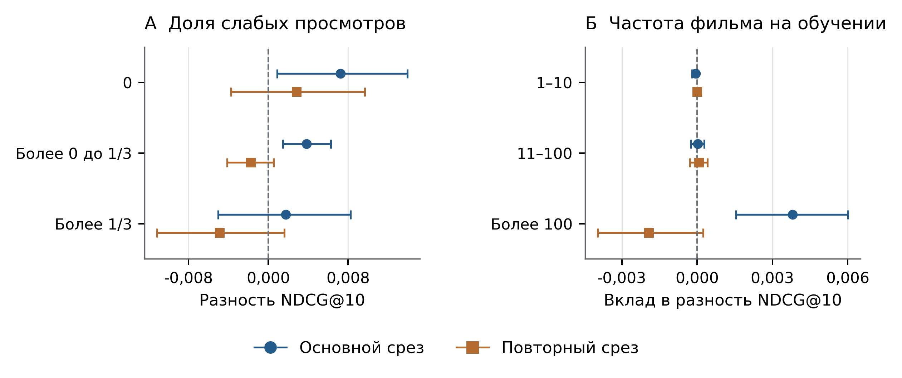

Дополнительный анализ не выявил устойчивого выбора между SOFT и DELETE10 по одной длине истории или доле слабых просмотров. Например, для историй 20–49 фильмов средняя разность SOFT − DELETE10 меняется с 0,003805 на основном срезе до −0,004203 на повторном. Доли групп по слабым просмотрам при этом близки: без таких просмотров — 8,20 и 8,65%, с долей до 1/3 включительно — 74,56 и 74,81% (рисунок 2А). Поэтому по этим данным нельзя обосновать переносимое правило переключения обработки для зрителей.

Разложение по фильмам локализует разность в популярной части каталога. На объекты с более чем 100 зрителями в обучающей когорте приходится 83,19 и 85,16% будущих целевых взаимодействий. Их аддитивный вклад в SOFT − DELETE10 составляет 0,003802 и −0,001925 (рисунок 2Б). Для менее популярных групп убедительного выигрыша SOFT не наблюдается. На основном срезе вклад фильма Wrath of Man равен 0,002224 — около 59% суммарной разности именно SOFT − DELETE10; на повторном его вклад отрицателен. Это описательная декомпозиция метрики, не причинное объяснение смены лидера. Улучшение средней оценки не доказывает улучшение рекомендаций редких фильмов.

Рисунок 2. Дополнительный анализ SOFT − DELETE10. А — разности NDCG@10 внутри групп по доле прошлых просмотров ≤10%; Б — аддитивные вклады групп фильмов по числу зрителей на обучении, с общим IDCG пользователя. Интервалы описательные 95%, условные на обученных моделях, без поправки на множественные сравнения.
